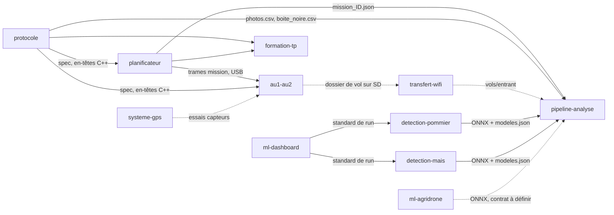

# GRAPH.md — modules, dépendances et données

Source de vérité unique. Vérification : `python tools/verifier_graph.py`.
Mise à jour : 30 octobre 2026.

## Modules

| Module (dossier = id Mermaid) | Rôle | Techno | Consomme | Fournit à | État |
|---|---|---|---|---|---|
| [`planificateur`](src/modules/planificateur/README.md) | Trace la mission sur carte, l'envoie à AU2 (USB), l'archive | JS + Python | `protocole` | `pipeline-analyse`, `formation-tp` | actif |
| [`protocole`](src/modules/protocole/README.md) | Protocole commun PC ↔ AU2 ↔ AU1, fichiers de vol, banc d'essai AU2 | C++ + Python | — | `planificateur`, `pipeline-analyse`, `formation-tp`, `au1-au2` | actif |
| [`pipeline-analyse`](src/modules/pipeline-analyse/README.md) | Analyse les photos d'un vol, produit `rapport.html` et les zones malades | Python | `planificateur`, `protocole`, `ml-dashboard` | — | actif (v1.1.0) |
| [`ml-dashboard`](src/modules/ml-dashboard/README.md) | Standard de run ML et validation (RunLogger et adaptateurs : voir README) | Python | — | `pipeline-analyse`, `detection-pommier`, `detection-mais` | actif (partiel) |
| [`detection-pommier`](src/modules/detection-pommier/README.md) | Préparation des données et entraînement sain / malade sur feuilles de pommier | notebooks Python | `ml-dashboard` | `pipeline-analyse` | actif |
| [`detection-mais`](src/modules/detection-mais/README.md) | Inventaire des données, préparation et entraînement maïs (YOLO, tuiles, RT-DETR) | notebooks Python | `ml-dashboard` | `pipeline-analyse` | actif |
| [`ml-agridrone`](src/modules/ml-agridrone/README.md) | Pile ML blé et olivier : données, entraînement, évaluation, export ONNX | Python (uv) | — | `pipeline-analyse` (contrat à définir) | actif |
| [`systeme-gps`](src/modules/systeme-gps/README.md) | Banc d'essai du GPS et du compas du Phantom 3 via Arduino Uno | Python + Arduino | — | `au1-au2` | actif (essais) |
| [`formation-tp`](src/modules/formation-tp/README.md) | TP guidé : planificateur web et protocole du drone | JS + Markdown | `planificateur`, `protocole` | — | actif |
| `au1-au2` | Programme de vol AU1 (pilotage) et AU2 (navigation, capteurs, LoRa, SD, caméra) | C++/Arduino | `protocole` | `pipeline-analyse` (via fichiers de vol) | planifié (dossier absent) |
| `transfert-wifi` | Transfert Wi-Fi des vols de la SD d'AU2 vers `data/vols/entrant/` | à choisir | `au1-au2` | `pipeline-analyse` | planifié (dossier absent) |

## Graphe

Trait pointillé : lien planifié ou contrat à définir. Les formats des liens pleins sont dans [`docs/contrats.md`](docs/contrats.md).

## Données (hors Git, sauf mention)

Racine : variable `DRONE_DATA_DIR`, sinon `data/`.

| Donnée | Chemin | Produite par | Lue par | État actuel |
|---|---|---|---|---|
| Missions archivées | `data/missions/mission_<id>.json`, `journal_planificateur.txt` | `planificateur` | `pipeline-analyse` | vide |
| Vols reçus | `data/vols/entrant/<vol>/` (`images/`, `photos.csv`, `boite_noire.csv`) | `transfert-wifi` (ou copie manuelle de la SD) | `pipeline-analyse` | vide |
| Résultats d'analyse | `data/vols/<date>_<id>/` (`rapport.html`, `resultats/`, `a_relabelliser/`, `brut/`) | `pipeline-analyse` | Tom | vide |
| Runs d'entraînement | `data/runs/<projet>/<run_id>/` | notebooks `detection-*` via `ml-dashboard` | `ml-dashboard` | vide |
| Dataset pommier | `data/datasets/pommier/raw/`, `archives/` | `detection-pommier` (téléchargement) | `detection-pommier` | ≈ 2,1 Go |
| Dataset maïs | `data/datasets/mais/` | `detection-mais` | `detection-mais` | vide |
| Modèles exportés | `data/models/` | `ml-dashboard` (export prévu) | `pipeline-analyse` (`modeles.json`) | à créer |
| Données blé / olivier | `src/modules/ml-agridrone/data/<projet>/`, `runs/<projet>/` | `ml-agridrone` | `ml-agridrone` | local au module |
| Vol de démonstration | `src/modules/pipeline-analyse/demo/` | `pipeline-analyse/demo.bat` | `pipeline-analyse` | généré |
| Archives locales | `_archive/` (ignoré par Git) | migration du 30 octobre 2026 | personne | environnement virtuel, zip, copie partielle |

## Écarts de contrat connus

- `camera.provisoire` : `planificateur` ne l'écrit pas dans `mission.json` ; `pipeline-analyse` avertit à chaque vol.
- `modeles.json` : l'export de `ml-dashboard` vers `pipeline-analyse` n'existe pas encore (type `a_definir` pour les trois cultures).
- `ml-dashboard` : le code présent est le livrable 1 (standard, validation). Les livrables 2 et 3 (RunLogger, adaptateurs) décrits dans `docs/notices/` ne sont pas dans ce dépôt.
- Pommier `deux_etages` : l'extracteur de feuilles sur image de drone manque.
- Pipeline : RT-DETR non pris en charge ; roulis et tangage absents de `photos.csv`.
- `ml-agridrone` : sa sortie ONNX n'est pas encore au format de `pipeline-analyse/modeles.json`.
- Doublon de responsabilités à arbitrer : `ml-agridrone` (MLflow, runs propres) et `ml-dashboard` (standard de run).
