# Résultats des baselines

_Chantiers 4 à 6, 7 octobre 2026._

Chaque chiffre vient d'un run identifié (dossier `runs/ble/`, empreinte de config, commit git
sans modification locale), relançable avec la commande indiquée. Les tableaux sont
produits à partir des fichiers `metrics.json` des runs, sans recopie à la main.

Machine : CPU à 4 cœurs (Xeon avec instructions AMX), sans GPU.

## En bref

- **Classifieur de maladies (§ 1)** : ConvNeXt-Tiny atteint 95 % d'exactitude sur le test
  John Innes. Sur des photos de terrain d'un autre pays (Henan, Chine), il tient 85 %
  (96 % sur les images qu'il décide). Sur des gros plans ou des feuilles tenues à la main,
  il déclare malades la plupart des feuilles saines. Une maladie jamais apprise peut
  passer pour « sain ». Il faut des images drone étiquetées de vos parcelles.
- **Modèle binaire sain / malade (§ 1.7)** : entraîné sur John Innes et Henan, il ne
  déclare saines que 0,3 % des images de quatre maladies jamais vues (Bangladesh), contre
  12,9 % pour le classifieur à 5 classes. Hors domaine, ses « sains » sont justes à
  91-98 %. En contrepartie, 4 à 36 % des images saines sont déclarées malades selon le
  jeu ; un seuil plus strict réduit encore les erreurs, au prix de davantage de sains à
  revoir.
- **Segmentation multispectrale (§ 2)** : un U-Net 5 bandes atteint 85,5 de mIoU sur
  WeedsGalore (culture / adventices). C'est au moins le niveau publié, et bien au-dessus
  des meilleurs seuils NDVI (53,5). Le red-edge et le proche infrarouge apportent
  +3 points sur le RVB seul. Le NDRE échoue sur des comptes non calibrés : la
  calibration radiométrique est un prérequis.
- **Export (§ 3)** : modèles ONNX vérifiés (écart inférieur à 10⁻⁵ avec PyTorch).
  - Sur le CPU de développement : 9 ms par image pour EfficientNet-B0, 35 ms pour
    ConvNeXt-Tiny, 40 tuiles de 256 px par seconde pour le U-Net.
  - Les temps Jetson restent à mesurer sur la cible (procédure fournie).

## 1. Classifieur de maladies du blé (chantier 4)

### 1.1 Protocole

| | |
|---|---|
| **Entraînement** | John Innes (Royaume-Uni), 699 images, 5 classes : sain, rouille jaune, rouille brune, septoriose, oïdium |
| **Validation** | John Innes, 150 images : choix du modèle (F1 macro) et calibration des seuils |
| **Test intra-source** | John Innes, 150 images (groupes disjoints de l'entraînement, voir [`data_pipeline.md`](data_pipeline.md) § 3) |
| **Tests inter-sources** | Éthiopie, 405 images (sain, rouille jaune, septoriose) ; YellowRust_22-23, 9 802 images (sain, rouille jaune). Jamais vus, ni à l'entraînement ni à la calibration |
| **Modèles** | EfficientNet-B0 (`efficientnet_b0.ra_in1k`, 4,0 M paramètres avec la tête à 5 classes, pré-entraîné sur ImageNet-1k) et ConvNeXt-Tiny (`convnext_tiny.fb_in22k_ft_in1k`, 27,8 M, pré-entraîné sur ImageNet-22k). Poids sous Apache-2.0, tête neuve à 5 sorties, tout le réseau affiné |
| **Entraînement** | 224 px ; AdamW ; une époque de montée puis décroissance en cosinus ; 25 époques au plus, arrêt après 8 sans progrès ; perte pondérée (classes équilibrées) ; augmentations « drone » ([`data_pipeline.md`](data_pipeline.md) § 4). EfficientNet en float32, ConvNeXt en bf16 |
| **Durée** | EfficientNet-B0 : 25 époques, 32 min (67 s par époque). ConvNeXt-Tiny : arrêt à l'époque 23, 34 min (80 s par époque) |
| **Évaluation** | plus petit côté ramené à 224 px, puis recadrage central ; float32 |

**Règle de décision.** Le modèle sort une probabilité par classe. La décision :

1. **« incertain »** si la probabilité maximale est sous un seuil `tau`, calibré sur la
   validation pour que 90 % des images reçoivent une décision ;
2. **« sain »** seulement si p(sain) atteint un second seuil `tau_sain`. Ce seuil est
   calibré pour qu'au plus 2 % des images malades de validation soient déclarées
   saines ; sinon l'image est « incertaine ».

Une plante malade déclarée saine est l'erreur coûteuse : la maladie n'est pas traitée.
Une image « incertaine » appelle un second regard (nouvelle prise de vue ou contrôle
humain). Les seuils sont enregistrés dans le checkpoint (`best.pt`) et dans la fiche du
modèle exporté.

Sur la validation, les deux modèles respectaient déjà la limite de 2 % avec `tau` seul :
`tau_sain` = `tau` (0,850 pour EfficientNet-B0, 0,897 pour ConvNeXt-Tiny).

**Métriques.**

| Métrique | Définition |
|---|---|
| **Ratés** | part des images malades déclarées saines |
| **Fausses alertes** | part des images saines déclarées malades. Les ratés se lisent toujours avec elles : un modèle qui alerte partout n'a aucun raté |
| **Couverture** | part des images qui reçoivent une décision |
| **Exactitude sélective** | exactitude sur les images décidées |
| **ECE** | écart moyen entre confiance annoncée et exactitude (0 = confiance fiable) |
| **AUROC sain/malade** | qualité du classement des images par p(sain), quel que soit le seuil (1 = parfait, 0,5 = hasard) |

Le F1 macro ne porte que sur les classes présentes dans le jeu évalué.

### 1.2 Résultats

Colonnes 4 à 7 : sans abstention (classe la plus probable). Colonnes 8 à 11 : avec la
règle de décision.

| Modèle | Jeu | n | Exactitude | F1 macro | Ratés | Fausses alertes | Couverture | Exactitude sélective | Ratés | Fausses alertes | ECE | AUROC sain/malade |
|---|---|--:|--:|--:|--:|--:|--:|--:|--:|--:|--:|--:|
| EfficientNet-B0 | John Innes, validation | 150 | 89,3 % | 0,886 | 2,3 % | 11,1 % | 90,7 % | 93,4 % | 1,5 % | 0,0 % | 0,08 | 0,99 |
| EfficientNet-B0 | John Innes, test | 150 | 86,0 % | 0,854 | 0,8 % | 23,5 % | 89,3 % | 90,3 % | 0,8 % | 23,5 % | 0,09 | 0,98 |
| EfficientNet-B0 | Éthiopie | 405 | 47,7 % | 0,419 | 3,6 % | 93,1 % | 57,3 % | 56,9 % | 0,7 % | 40,6 % | 0,36 | 0,64 |
| EfficientNet-B0 | YellowRust 22-23 | 9 802 | 43,4 % | 0,322 | 0,0 % | 99,6 % | 68,7 % | 51,4 % | 0,0 % | 62,5 % | 0,44 | 0,79 |
| **ConvNeXt-Tiny** | John Innes, validation | 150 | 96,0 % | 0,966 | 0,0 % | 5,6 % | 90,7 % | 99,3 % | 0,0 % | 0,0 % | 0,03 | 1,00 |
| **ConvNeXt-Tiny** | John Innes, test | 150 | **95,3 %** | **0,952** | 0,8 % | 5,9 % | 82,7 % | **100,0 %** | 0,0 % | 0,0 % | 0,03 | 1,00 |
| **ConvNeXt-Tiny** | Éthiopie | 405 | **70,1 %** | **0,750** | 0,3 % | 53,5 % | 44,4 % | 82,8 % | 0,0 % | 16,8 % | 0,14 | 0,97 |
| **ConvNeXt-Tiny** | YellowRust 22-23 | 9 802 | 39,2 % | 0,446 | 0,4 % | 87,0 % | 7,7 % | 47,7 % | 0,0 % | 4,2 % | 0,22 | 0,90 |

F1 par classe, sans abstention ; R = rappel. « — » : classe absente du jeu.

| Modèle | Jeu | sain | rouille jaune | rouille brune | septoriose | oïdium |
|---|---|--:|--:|--:|--:|--:|
| EfficientNet-B0 | John Innes, test | 0,84 (R 76,5 %) | 0,87 (R 89,2 %) | 0,82 (R 84,2 %) | 0,87 (R 83,9 %) | 0,87 (R 95,2 %) |
| EfficientNet-B0 | Éthiopie | 0,12 (R 6,9 %) | 0,64 (R 68,1 %) | — | 0,50 (R 46,4 %) | — |
| EfficientNet-B0 | YellowRust 22-23 | 0,01 (R 0,4 %) | 0,64 (R 84,8 %) | — | — | — |
| ConvNeXt-Tiny | John Innes, test | 0,94 (R 94,1 %) | 0,93 (R 94,6 %) | 0,95 (R 94,7 %) | 0,96 (R 94,6 %) | 0,98 (R 100,0 %) |
| ConvNeXt-Tiny | Éthiopie | 0,63 (R 46,5 %) | 0,86 (R 83,1 %) | — | 0,76 (R 67,0 %) | — |
| ConvNeXt-Tiny | YellowRust 22-23 | 0,23 (R 13,0 %) | 0,66 (R 64,5 %) | — | — | — |

**Écarts significatifs ?** Les intervalles de confiance à 95 % (Wilson) de l'exactitude
sont les suivants :

| Jeu | EfficientNet-B0 | ConvNeXt-Tiny |
|---|--:|--:|
| Test John Innes | 80 à 91 % | 91 à 98 % |
| Éthiopie | 43 à 53 % | 66 à 74 % |

Sur les mêmes images, le test de McNemar donne ConvNeXt-Tiny meilleur, avec
p = 0,0005 (test John Innes) et p < 10⁻¹¹ (Éthiopie). Sur YellowRust, l'exactitude
d'EfficientNet-B0 est plus haute (43 % contre 39 %), mais pour une mauvaise raison : il
déclare presque toutes les images « rouille jaune ». Son F1 macro (0,32 contre 0,45) et
son AUROC (0,79 contre 0,90) sont moins bons.

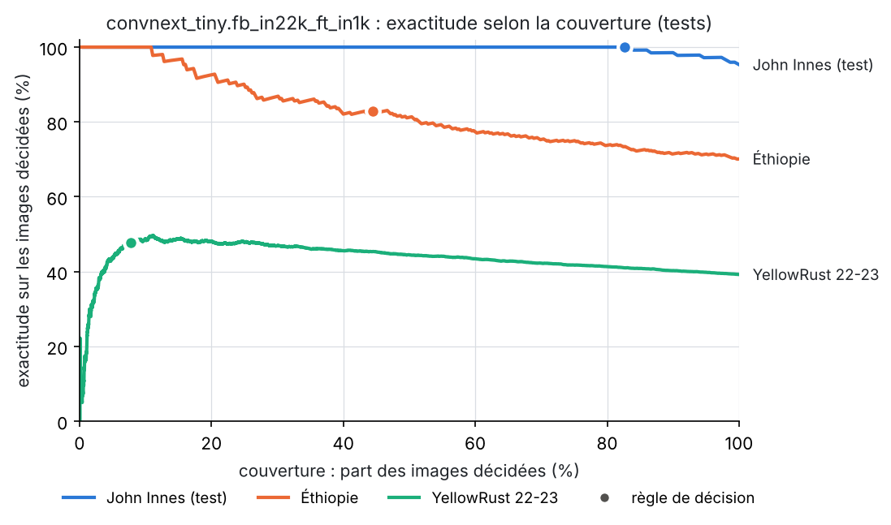
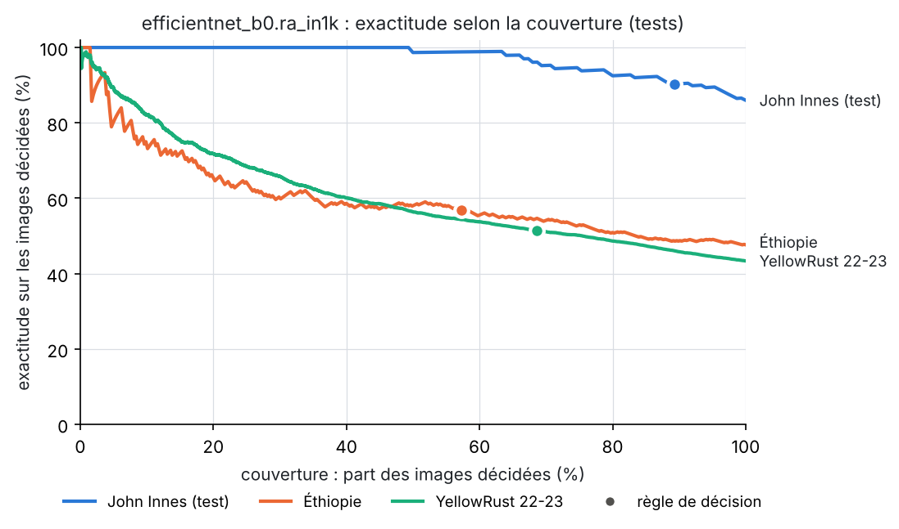
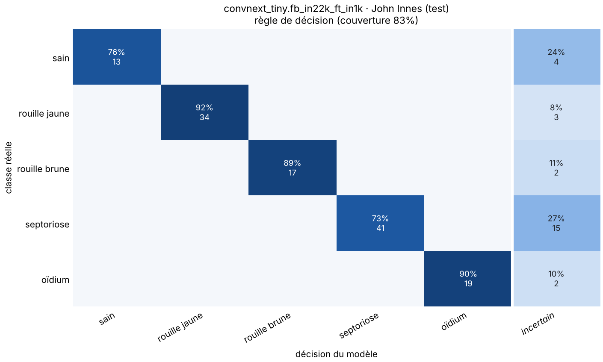
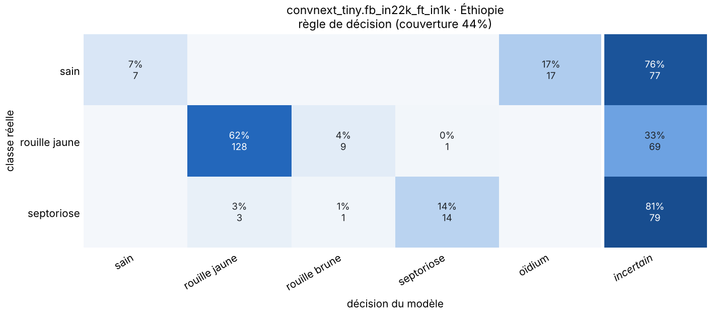
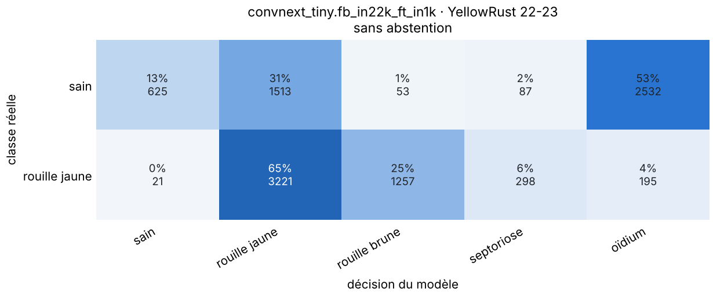
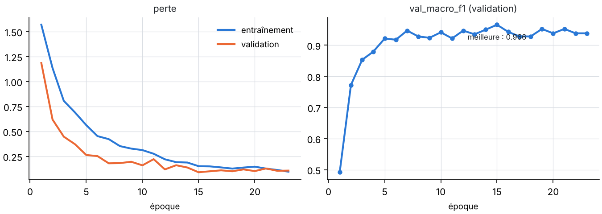

### 1.3 Lecture

**ConvNeXt-Tiny est la baseline à retenir.** En domaine, il atteint 95 % d'exactitude
et 0,95 de F1 macro, contre 86 % et 0,85 pour EfficientNet-B0. Il ne fait que 6 % de
fausses alertes, contre 24 %. Avec la règle de décision, il décide 83 % des images de
test et ne s'y trompe jamais : aucun raté, aucune fausse alerte. Il transfère aussi
mieux, avec 70 % d'exactitude en Éthiopie contre 48 %, et sa confiance est mieux
calibrée.

L'écart vient probablement de son pré-entraînement sur ImageNet-22k (14 millions
d'images), plus général qu'ImageNet-1k, et de sa taille. Il a 7 fois plus de
paramètres et demande 12 fois plus de calcul ; son temps d'inférence est mesuré au § 3.

**Hors domaine, les deux modèles échouent sur les feuilles saines.** Ils ont appris ce
qu'est un *couvert sain photographié par John Innes*, pas l'absence de symptômes. Une
feuille saine tenue à la main (Éthiopie), ou vue de très près (YellowRust), ne
ressemble à rien de ce qu'ils ont vu comme « sain ».

- ConvNeXt-Tiny déclare malades 54 % des feuilles saines d'Éthiopie (surtout
  « oïdium ») et 87 % de celles de YellowRust.
- EfficientNet-B0 en déclare malades 93 % et 99,6 %.
- Les ratés quasi nuls sont donc trompeurs.

La rouille jaune reste en partie reconnue par ConvNeXt-Tiny : rappel de 83 % en
Éthiopie et de 65 % sur YellowRust. Sur YellowRust, un quart des rouilles jaunes sont
prises pour de la rouille brune : à cette échelle, les deux rouilles se distinguent mal.

**La sortie « incertain » se comporte bien avec ConvNeXt-Tiny, mal avec
EfficientNet-B0.**

- **ConvNeXt-Tiny** s'abstient sur 92 % des images de YellowRust et sur 56 % en
  Éthiopie. Les fausses alertes tombent alors à 4 % et 17 %, sans aucun raté. Il dit
  « je ne sais pas » au lieu de se tromper avec assurance, ce qui est le comportement
  voulu. Le prix est un jeu d'images presque entièrement à revoir à la main.
- **EfficientNet-B0** garde 41 % et 63 % de fausses alertes malgré la règle.

La confiance reste toutefois un garde-fou imparfait. Sur YellowRust, le 1 % d'images où
ConvNeXt-Tiny est le plus sûr de lui (au-delà de 97 %) n'est juste qu'à 16 %. Ce sont
surtout des rouilles jaunes prises pour de la rouille brune : la maladie est tout de
même signalée.

**Recalibrer sur le terrain aide, mais ne suffit pas.** L'AUROC sain/malade de
ConvNeXt-Tiny reste élevée hors domaine : 0,97 en Éthiopie et 0,90 sur YellowRust. Il
range donc encore les images saines avant les malades, même si ses seuils ne sont plus
bons.

Simulation : on choisit le seuil « sain » sur 50 images étiquetées de la cible, en
visant au plus 2 % de ratés, puis on le mesure sur le reste du jeu (300 tirages,
médianes) :

| Modèle | Fausses alertes, Éthiopie | Fausses alertes, YellowRust |
|---|--:|--:|
| ConvNeXt-Tiny | 32 % | 57 % |
| EfficientNet-B0 | 96 % | 87 % |

Avec 200 images au lieu de 50, ces chiffres changent peu (31 % et 61 %). En domaine, ConvNeXt-Tiny
fait 6 % de fausses alertes. Un recalibrage léger ne remplace donc pas des images de la
cible **à l'entraînement**.

### 1.4 Conséquences pour le projet

1. **Les jeux publics ne suffisent pas pour un classifieur de terrain.** Ils servent de
   pré-entraînement et de banc d'essai pour la chaîne : données, découpage, règle de
   décision, export. Aucun ne reproduit la vue de votre drone.
2. **Étape décisive : un jeu d'images drone étiquetées de vos parcelles.**
   - Plusieurs parcelles, dates, stades et conditions de lumière.
   - Un découpage par parcelle et par date : jamais d'images voisines entre
     entraînement et test.
   - **Des images saines variées** : c'est la classe qui ne se transfère pas.

   Partir de ConvNeXt-Tiny entraîné ici, puis l'affiner sur ces images.
3. **Fixer la cible avec les deux erreurs.** Par exemple : au plus 2 % de ratés **et**
   au plus 10 % de fausses alertes, mesurés sur vos images, avec une couverture
   acceptable pour l'opérateur.
4. **Pistes techniques**, à évaluer sur vos données :
   - une résolution d'entrée plus haute, ou un découpage de l'image en tuiles (les
     pustules et taches sont petites à 224 px) ;
   - une détection hors domaine plus robuste que la probabilité maximale ;
   - le jeu complet de John Innes (19 172 images, sur demande).

### 1.5 Reproduire

```bash
uv run agridrone data prepare-classification
uv run agridrone train -c ble/configs/classification/efficientnet_b0.yaml num_workers=2
uv run agridrone train -c ble/configs/classification/convnext_tiny.yaml num_workers=2
```

| Modèle | Run | Commit | Empreinte de config |
|---|---|---|---|
| EfficientNet-B0 | `runs/ble/classification/20261007-143021_efficientnet_b0_87b70abd` | `7cbf0cb` | `87b70abd…` |
| ConvNeXt-Tiny | `runs/ble/classification/20261007-150515_convnext_tiny_cf773d7e` | `84cd49d` | `cf773d7e…` |

Le code d'entraînement est identique entre ces deux commits. L'AUROC sain/malade a
été ajoutée à l'évaluation après ces deux runs (commit `0a0ad19`). Pour eux, elle est
calculée à partir des prédictions enregistrées (`eval/<ensemble>/predictions.csv`).

### 1.6 Deux nouveaux jeux de test (8 octobre 2026)

Une recherche multi-sources a relevé 91 candidats distincts. Elle couvrait les dépôts
académiques, Kaggle, Hugging Face et GitHub, la science participative et la littérature
(inventaire, § 7.5). Elle a été interrompue deux fois par la limite d'usage.

Deux jeux ont été retenus après vérification à la source, à l'aide de l'API Zenodo et
des sommes md5. Aucune de leurs images n'est un quasi-doublon d'une image
d'entraînement. Les découpages existants sont inchangés (vérifié), donc les deux modèles
du § 1.2 sont évalués tels quels, avec les mêmes seuils.

| Jeu | Contenu | Licence | Vérification |
|---|---|---|---|
| **Henan (Chine)**, Ma et al. 2024, [zenodo 15621359](https://zenodo.org/records/15621359) | Photos smartphone au champ (feuilles et épis), 2 402 images retenues : 945 saines (444 feuilles, 501 épis), 632 rouille brune, 434 rouille jaune, 391 oïdium | CC BY 4.0 | Déposé par le premier auteur de l'article. Sans EXIF, tailles disparates : statut **candidate**, test seulement |
| **Tekirdağ (Turquie)**, Önler & Köycü 2024, [zenodo 13137587](https://zenodo.org/records/13137587) | Gros plans de feuilles au smartphone (iPhone 8, mai 2023), 408 images, toutes d'oïdium | CC BY 4.0 | Collecte originale (EXIF cohérents) |

Mêmes colonnes qu'au § 1.2 :

| Modèle | Jeu | n | Exactitude (IC 95 %) | F1 macro | Ratés | Fausses alertes | Couverture | Exactitude sélective | Ratés | Fausses alertes | ECE | AUROC sain/malade |
|---|---|--:|--:|--:|--:|--:|--:|--:|--:|--:|--:|--:|
| **ConvNeXt-Tiny** | Henan (Chine) | 2 402 | **84,9 %** (83 à 86 %) | **0,850** | 0,8 % | 28,5 % | 70,6 % | **95,8 %** | 0,4 % | 4,6 % | 0,05 | 0,99 |
| **ConvNeXt-Tiny** | Tekirdağ (Turquie) | 408 | 53,4 % (49 à 58 %) | 0,696 | 2,2 % | — | 43,1 % | 77,3 % | 0,0 % | — | 0,27 | — |
| EfficientNet-B0 | Henan (Chine) | 2 402 | 54,5 % (52 à 56 %) | 0,554 | 2,4 % | 53,1 % | 59,8 % | 63,4 % | 1,0 % | 21,7 % | 0,29 | 0,91 |
| EfficientNet-B0 | Tekirdağ (Turquie) | 408 | 37,3 % (33 à 42 %) | 0,543 | 5,6 % | — | 56,6 % | 39,8 % | 2,9 % | — | 0,45 | — |

F1 par classe, sans abstention ; R = rappel.

| Modèle | Jeu | sain | rouille jaune | rouille brune | oïdium |
|---|---|--:|--:|--:|--:|
| ConvNeXt-Tiny | Henan (Chine) | 0,83 (R 71,5 %) | 0,77 (R 98,4 %) | 0,98 (R 97,6 %) | 0,82 (R 81,8 %) |
| ConvNeXt-Tiny | Tekirdağ (Turquie) | — | — | — | 0,70 (R 53,4 %) |
| EfficientNet-B0 | Henan (Chine) | 0,62 (R 46,9 %) | 0,52 (R 79,5 %) | 0,56 (R 57,0 %) | 0,51 (R 41,2 %) |
| EfficientNet-B0 | Tekirdağ (Turquie) | — | — | — | 0,54 (R 37,3 %) |

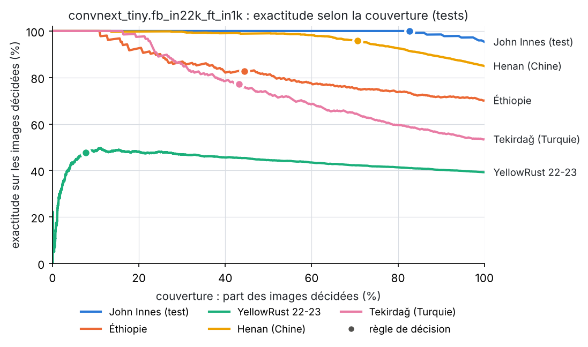
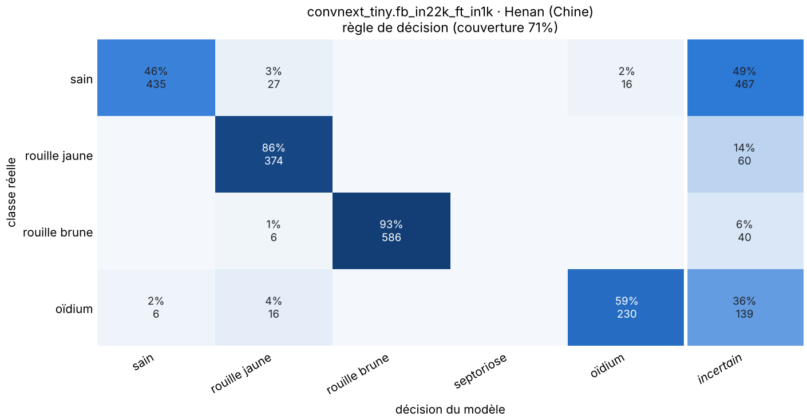
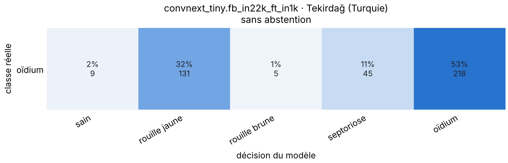

**Lecture.**

- **Sur des photos de terrain d'un autre pays, ConvNeXt-Tiny tient bien.**
  - Il atteint 85 % d'exactitude au Henan. Sa confiance y reste fiable : ECE de 0,05,
    proche des 0,03 en domaine.
  - Avec la règle de décision, il décide 71 % des images. Il y a raison à 96 %, avec
    0,4 % de ratés et 4,6 % de fausses alertes.
  - Les rouilles sont reconnues à 98 %.
  - EfficientNet-B0 transfère beaucoup moins bien (54,5 %), ce qui confirme le choix du
    § 1.3.
- **Le point de vue compte davantage que le pays.** Les images du Henan, comme celles de
  John Innes, sont des vues de terrain, et le transfert fonctionne. Les jeux où il échoue
  sont des gros plans ou des feuilles tenues devant un fond neutre :
  - Tekirdağ : 53 % de rappel pour l'oïdium, dont 32 % pris pour de la rouille jaune ;
  - YellowRust ;
  - en partie l'Éthiopie.

  Votre drone donnera encore un autre point de vue, vu de dessus et à quelques mètres.
  Il faudra le mesurer sur vos propres images.
- **Les fausses alertes restantes ont deux causes identifiables** :
  - des épis sains en cours de maturation, jaunissants, pris pour de la rouille jaune :
    177 sur 501 ;
  - des feuilles saines prises pour de l'oïdium : 69 sur 444.

  La règle en renvoie l'essentiel vers « incertain ». Il reste 5,2 % d'alertes à tort sur
  les épis sains et 3,8 % sur les feuilles saines.

**Maladies hors périmètre.** Le jeu du Henan contient aussi deux maladies de l'épi que
le modèle n'a jamais apprises. Ce qu'en dit ConvNeXt-Tiny avec la règle de décision
(`eval-nouveaux-tests/hors_perimetre.json`) :

| Maladie (jamais apprise) | n | « incertain » | déclarée **saine** | une maladie apprise |
|---|--:|--:|--:|--:|
| Fusariose de l'épi (Scab) | 1 276 | 90,5 % | 2,8 % | 6,7 % |
| Septoriose de l'épi (Glume blotch) | 465 | 61,5 % | **38,3 %** | 0,2 % |

La sortie « incertain » attrape la plupart des fusarioses. En revanche, plus d'un épi sur
trois atteint de septoriose de l'épi est déclaré sain, en toute confiance : **une maladie
absente de l'entraînement peut passer pour « sain »**. Pour un produit, la liste des
classes doit donc couvrir les maladies de l'épi présentes en France (fusariose,
septoriose de l'épi). Ce jeu sous CC BY 4.0 en fournit des exemples, à condition de
confirmer sa provenance avant d'entraîner dessus.

**Reproduire.**

```bash
uv run agridrone data download --project ble henan_wheat_disease tekirdag_powdery_mildew
uv run agridrone data prepare-classification
uv run agridrone evaluate --run runs/ble/classification/<run> --out runs/ble/classification/<run>/eval-nouveaux-tests \
  "data.test_splits=[test,test_ethiopia_wheat_leaf,test_kaggle_yellowrust_2223,test_henan_wheat_disease,test_tekirdag_powdery_mildew]" \
  "data.split_names.test_henan_wheat_disease=Henan (Chine)" "data.split_names.test_tekirdag_powdery_mildew=Tekirdağ (Turquie)"
```

### 1.7 Modèle binaire « sain fiable » (8 octobre 2026)

**But.** Un modèle complémentaire qui ne répond que « sain » ou « malade », quelle que
soit la maladie. Quand il dit « sain », il doit avoir raison : c'est la parade aux
maladies absentes de la liste du classifieur à 5 classes (§ 1.6).

**Données** (`ble/configs/data/classification_binaire.yaml`, jeu préparé à part dans
`data/ble/processed/classification_binaire`).

- **Entraînement** : John Innes et Henan. La classe « malade » couvre ainsi sept états :
  rouilles jaune et brune, oïdium, septoriose, fusariose de l'épi, septoriose de l'épi.
  La classe « sain » réunit feuilles et épis.
- **Découpage** : 3 606 images d'entraînement, 773 de validation, 772 de test, chaque
  ensemble comptant environ 20 % d'images saines.
- **Tests inter-sources, jamais vus** :
  - Éthiopie, YellowRust et Tekirdağ ;
  - **Bangladesh** (Mendeley [doi:10.17632/5gc7hwydwg.1](https://doi.org/10.17632/5gc7hwydwg.1),
    CC BY 4.0, photos de terrain 2025) : 248 saines et **4 maladies absentes de
    l'entraînement**, à savoir point noir, piétin fusarien, helminthosporiose et
    pyriculariose.
- **Images augmentées du Bangladesh** : elles ne sont même pas extraites de l'archive
  (nouvelle option `extract_only` du registre).

**Modèle et règle.**

- ConvNeXt-Tiny, 8 époques, float32 (37 min). Meilleure époque : la 6e.
- « Sain » si p(sain) atteint le seuil, sinon « malade ». Il n'y a pas de sortie
  « incertain » : le doute vaut « malade ». Dans les sorties d'`agridrone evaluate`, ces
  images apparaissent sous la décision `uncertain` : elles sont comptées ici comme
  « malade ».
- Deux seuils, tous deux choisis sur la validation :

| Mode | Seuil | Règle de calibration (validation) |
|---|--:|---|
| **équilibré** | 0,50 | au plus 1 % de malades déclarés sains (0,65 % obtenu) |
| **sain très sûr** | 0,969 | aucun malade déclaré sain sur les 612 de la validation |

**Résultats sur les jeux jamais vus.** La précision du « sain » est la part d'images
vraiment saines parmi celles déclarées saines.

| Jeu | Mode | Précision du « sain » | Sains reconnus | Malades déclarés sains |
|---|---|--:|--:|--:|
| Éthiopie | équilibré | 90,7 % | 96,0 % | 3,3 % |
| Éthiopie | sain très sûr | 98,9 % | 91,1 % | 0,3 % |
| YellowRust 22-23 | équilibré | 98,1 % | 79,7 % | 1,5 % |
| YellowRust 22-23 | sain très sûr | 99,9 % | 16,0 % | 0,02 % |
| Bangladesh (maladies jamais vues) | équilibré | 98,1 % | 63,7 % | 0,3 % |
| Bangladesh (maladies jamais vues) | sain très sûr | 100,0 % | 14,9 % | 0,0 % |
| Tekirdağ (oïdium seulement) | équilibré | — | — | 0,5 % |
| Tekirdağ (oïdium seulement) | sain très sûr | — | — | 0,0 % |

Sans seuil (classe la plus probable), l'AUROC sain/malade atteint 0,995 en Éthiopie,
0,984 sur YellowRust et 0,989 au Bangladesh. Le calibrage reste bon hors domaine (ECE de
0,006 à 0,032).

**Comparaison avec le classifieur à 5 classes**, chacun avec sa propre règle (pour le
5 classes, « incertain » compte comme « malade ») :

| Jeu | Modèle | Précision du « sain » | Sains reconnus | Malades déclarés sains |
|---|---|--:|--:|--:|
| Éthiopie | binaire, équilibré | 90,7 % | 96,0 % | 3,3 % |
| Éthiopie | 5 classes | 100 % | 6,9 % | 0 % |
| YellowRust 22-23 | binaire, équilibré | 98,1 % | 79,7 % | 1,5 % |
| YellowRust 22-23 | 5 classes | 100 % | 0,1 % | 0 % |
| Bangladesh | binaire, équilibré | **98,1 %** | 63,7 % | **0,3 %** |
| Bangladesh | 5 classes | 35,2 % | 33,5 % | 12,9 % |

Maladies **jamais vues** déclarées saines :

| Maladie (Bangladesh) | n | binaire (équilibré) | 5 classes |
|---|--:|--:|--:|
| Point noir (épis) | 296 | 1,0 % | 34,8 % |
| Pyriculariose (épis) | 291 | 0,0 % | 15,1 % |
| Helminthosporiose (feuilles) | 356 | 0,0 % | 1,7 % |
| Piétin fusarien (pied) | 247 | 0,0 % | 0,0 % |

**Lecture.**

- **Le modèle binaire fait ce qui était demandé.** Une maladie qu'il n'a jamais vue
  n'est presque jamais déclarée saine : 0,3 % au Bangladesh, contre 12,9 % pour le
  classifieur à 5 classes. En mode équilibré, ses « sains » sont justes à 91-98 % hors
  domaine.
- **Le classifieur à 5 classes ne peut pas jouer ce rôle.** Hors domaine, il ne dit
  presque jamais « sain » (Éthiopie, YellowRust). Sur des maladies inconnues, il prend
  le point noir pour un épi sain dans un cas sur trois.
- **Pourquoi le binaire transfère-t-il bien mieux ?** Trois raisons probables :
  - cinq fois plus de données ;
  - deux sources et deux points de vue à l'entraînement ;
  - une tâche plus simple, qui ne demande pas de distinguer les maladies entre elles.
- **Le coût est connu : des sains déclarés malades**, la classe saine restant la plus
  difficile à transférer. Le mode « sain très sûr » ne se trompe presque jamais, mais ne
  reconnaît que 15 à 16 % des sains sur YellowRust et au Bangladesh, et 91 % en Éthiopie.
  Le choix du seuil est un choix métier : combien d'images saines êtes-vous prêt à faire
  revoir pour ne pas manquer une maladie ?
- **Réserves.**
  - Les scores internes (validation et test John Innes + Henan, 99,4 %) sont optimistes :
    les séries de photos du Henan ne peuvent pas être regroupées sans EXIF.
  - Au Bangladesh, l'appareil photo change selon la classe ; ce jeu ne sert qu'au test.
  - Un seul entraînement a été réalisé, avec une seule graine.

**Pour le vote à trois modèles** que vous envisagez, ce modèle apporte un avis
réellement différent : autres données, autre tâche, et ses erreurs portent sur d'autres
images. Pour une règle à la fois prudente et simple :

1. une image n'est « saine » que si le modèle binaire le dit ;
2. le classifieur à 5 classes ne sert alors qu'à nommer la maladie.

Les deux combinaisons, vote à la majorité et règle prudente, pourront être mesurées sur
les prédictions déjà enregistrées.

**Reproduire.**

```bash
uv run agridrone data download --project ble henan_wheat_disease tekirdag_powdery_mildew bangladesh_wheat_disease
uv run agridrone data prepare-classification --data-config ble/configs/data/classification_binaire.yaml
uv run agridrone train -c ble/configs/classification/binaire_convnext_tiny.yaml num_workers=3 train.precision=fp32
uv run agridrone evaluate --run runs/ble/classification/<run> --out runs/ble/classification/<run>/eval-strict eval.max_missed_rate=0.0
```

Run : `runs/ble/classification/20261008-032124_binaire_convnext_tiny_421963dd` (commit
`2b76b86`, empreinte `421963dd…`). La précision fp32 a été passée en ligne de commande :
le processeur de cette session n'a pas d'AMX, et le bf16 y est émulé, trois fois plus
lent.
Résultats : `eval/` (mode équilibré) et `eval-strict/` (mode sain très sûr,
`eval.max_missed_rate=0.0`) ; la comparaison avec le classifieur à 5 classes est dans
`eval/comparaison_5_classes.json`.

## 2. Segmentation multispectrale (chantier 5)

### 2.1 Pourquoi WeedsGalore, et ce que cela valide

Aucun jeu public ouvert ne fournit d'images multispectrales de blé avec des zones malades
étiquetées au pixel (inventaire, § 7.2). La chaîne N bandes est donc validée sur
**WeedsGalore** (Celikkan et al., WACV 2025), la tâche ouverte la plus proche :

- **Capteur** : DJI P4 Multispectral, 5 bandes (B, V, R, RE, PIR), un capteur
  agricole courant.
- **Prise de vue** : maïs, vol à 5 m, soit 2,5 mm par pixel.
- **Masques** : annotations manuelles au pixel, en 3 classes (fond, culture,
  adventice).
- **Découpage officiel spatial** : 8, 2 et 2 parcelles. Une localisation n'apparaît
  jamais dans deux ensembles.

Ce chantier établit trois choses pour le projet :

- le code est générique en nombre de bandes ;
- on sait comparer un réseau à des seuils d'indices sur une vraie vérité terrain ;
- on mesure ce qu'apportent le red-edge et le proche infrarouge par rapport au RVB.

Il ne dit **rien** de la détection de maladies du blé : c'est la même chaîne, sur une
autre tâche.

### 2.2 Protocole

- **Données** :
  - 104 images d'entraînement, 26 de validation et 26 de test, de 600×600 px chacune ;
  - le sol occupe 93 % des pixels, la culture 2 %, les adventices 4 % ;
  - valeurs = comptes bruts 16 bits divisés par 65 535 (non calibrés) ;
  - normalisation z-score par bande, avec les statistiques de l'ensemble d'entraînement
    (`band_stats_train.json`).
- **U-Net** :
  - encodeur ResNet-18 (`tu-resnet18.a1_in1k`, poids ImageNet sous Apache-2.0), première
    convolution adaptée au nombre de bandes ;
  - recadrages aléatoires de 256 px, 4 par image et par époque ;
  - augmentations qui préservent les rapports entre bandes ;
  - perte entropie croisée + Dice, AdamW, entraînement en bf16 ;
  - 40 époques au plus, modèle choisi sur le mIoU de validation ;
  - inférence par tuiles de 256 px avec 64 px de chevauchement, comme sur une
    orthomosaïque.
- **Ablation** : le même U-Net sur les 3 bandes visibles seulement (R, V, B).
- **Baselines par indices**, seuils estimés sur l'entraînement seulement :
  - NDVI = (PIR − R) / (PIR + R) et NDRE = (PIR − RE) / (PIR + RE) ;
  - un seuil, fond contre végétation : **Otsu** (non supervisé) ou **seuil supervisé**
    (le meilleur possible pour l'IoU de la végétation) ;
  - deux seuils, trois classes : **multi-Otsu**, ou **deux seuils supervisés** (les
    meilleurs possibles pour le mIoU, ordre des classes compris). Ces derniers donnent
    la meilleure performance qu'un indice seul puisse atteindre.
- **Métriques** :
  - IoU et F1 par classe et mIoU, calculés sur la matrice de confusion cumulée de tout
    le test ;
  - IoU de la tâche fusionnée fond / végétation, la seule que les méthodes à un seuil
    savent traiter.

### 2.3 Résultats (test, 26 images)

En pourcentage.

| Méthode | IoU fond | IoU culture | IoU adventice | mIoU | F1 culture | F1 adventice | IoU végétation |
|---|--:|--:|--:|--:|--:|--:|--:|
| **U-Net 5 bandes** (B, V, R, RE, PIR) | 98,6 | 77,8 | 80,0 | **85,5** | 87,5 | 88,9 | 83,6 |
| U-Net 3 bandes (R, V, B) | 98,1 | 73,2 | 75,4 | **82,3** | 84,5 | 86,0 | 78,6 |
| NDVI, 2 seuils supervisés (+0,191 ; +0,414) | 97,4 | 26,9 | 36,3 | **53,5** | 42,4 | 53,2 | 71,3 |
| NDVI, multi-Otsu (−0,094 ; +0,168) | 44,1 | 0,4 | 51,1 | **31,9** | 0,8 | 67,7 | 12,1 |
| NDVI, seuil supervisé (+0,195) | 97,5 | — | — | — | — | — | 71,5 |
| NDVI, Otsu (+0,090) | 93,9 | — | — | — | — | — | 53,7 |
| NDRE, 2 seuils supervisés (+0,078 ; +0,109) | 88,4 | 3,3 | 6,6 | **32,8** | 6,3 | 12,4 | 10,3 |
| NDRE, multi-Otsu (−0,055 ; +0,035) | 37,4 | 4,1 | 5,1 | **15,5** | 8,0 | 9,6 | 9,7 |
| NDRE, seuil supervisé (+0,027) | 79,6 | — | — | — | — | — | 13,3 |
| NDRE, Otsu (−0,016) | 61,1 | — | — | — | — | — | 12,4 |

**Référence publiée** : Celikkan et al., WACV 2025, tableau 3, test, 3 classes. Chiffres
vérifiés dans l'article.

| Modèle | Entrée | IoU fond | IoU culture | IoU adventice | mIoU |
|---|---|--:|--:|--:|--:|
| DeepLabv3+ ResNet-50 | RVB | 97,97 | 67,93 | 72,08 | 79,33 |
| DeepLabv3+ ResNet-50 | 5 bandes | 98,45 | 72,93 | 77,31 | 82,90 |
| MaskFormer | RVB | 97,73 | 70,18 | 69,85 | 79,26 |
| MaskFormer | 5 bandes | 97,99 | 69,49 | 73,33 | 80,27 |

La comparaison reste indicative :

- l'article ne précise pas comment l'IoU est agrégée sur le test (cumulée ou moyenne par
  image) ;
- les modèles diffèrent ;
- chaque configuration n'a qu'un entraînement, de graine 42.

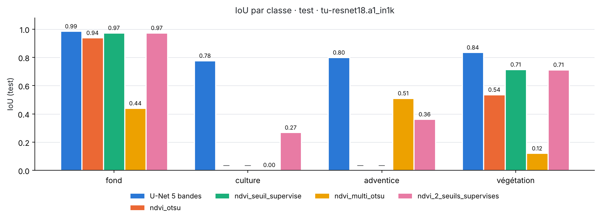
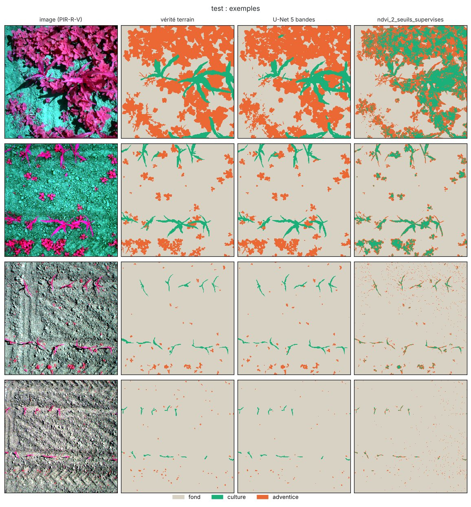

### 2.4 Lecture

**Le U-Net fait au moins aussi bien que les références publiées, sur CPU.** Il atteint
85,5 de mIoU en 5 bandes et 82,3 en RVB. L'article publié rapporte 82,9 et 79,3 avec un
DeepLabv3+ sur GPU, sous les réserves ci-dessus.

La structure en U conserve les détails fins, ce qui compte pour les jeunes plants de
quelques pixels. Chaque entraînement a pris 33 minutes sur 4 cœurs. Le modèle 5 bandes
progressait encore à la 40e et dernière époque : un entraînement plus long l'améliorerait
probablement.

**Le red-edge et le proche infrarouge apportent +3,2 points de mIoU**, surtout sur les
adventices (+4,6 points d'IoU). C'est cohérent avec l'article (+3,6 avec DeepLabv3+). Le
gain est régulier d'une image à l'autre : le modèle 5 bandes fait mieux que le RVB sur
24 images de test sur 26 en mIoU, et sur les 26 pour les adventices (test de Wilcoxon
apparié, p < 10⁻⁶). La variabilité d'un entraînement à l'autre n'a pas été mesurée,
faute de temps de calcul.

**Les seuils d'indice séparent le sol de la végétation, pas la culture des adventices.**

- **Fond contre végétation** : même le meilleur seuil NDVI n'atteint que 71,5 d'IoU de
  végétation, contre 83,6 pour le U-Net.
- **Trois classes** : les deux meilleurs seuils NDVI possibles plafonnent à 53,5 de
  mIoU, contre 85,5. Les distributions de NDVI de la culture et des adventices se
  chevauchent : médianes 0,39 et 0,29 sur 30 images d'entraînement.
- **Multi-Otsu** : il échoue complètement, car avec 93 % de sol ses seuils découpent le
  mode du sol lui-même.

**Le NDRE ne fonctionne pas sur ces données, et c'est une question de calibration.**

- Sur des comptes bruts non calibrés, le red-edge de la culture est presque au niveau
  du proche infrarouge : médianes 0,57 et 0,60.
- Le NDRE du sol (médiane −0,04) et celui de la végétation (+0,03) se recouvrent donc,
  et aucun seuil ne les sépare.
- Le NDVI survit parce que l'écart rouge / proche infrarouge est grand.

Les seuils fixés sur un jeu ne valent pas pour un autre vol. Sur les images de début de
saison, le NDVI du sol est plus élevé, et les seuils tirés de l'ensemble d'entraînement
y étiquettent du sol en végétation (exemples ci-dessus). Le U-Net, lui, s'appuie sur la
forme et le contexte.

### 2.5 Conséquences pour le projet

1. **La chaîne N bandes est prête.** Une fois vos données drone étiquetées, passer du
   maïs au blé, et des adventices aux zones malades, demande seulement :
   - de nouvelles classes ;
   - les noms des bandes de votre capteur (`configs/sensors/`) ;
   - un découpage par parcelle et par date.
2. **Calibrer les images en réflectance** : panneau de calibration avant chaque vol et
   capteur d'ensoleillement. Sans cela, les indices sont faussés (cas du NDRE ici), et ni
   les seuils ni les modèles ne se transfèrent d'un vol à l'autre.
3. **Le multispectral apporte un gain réel mais modéré** sur cette tâche (+3 points). Ce
   gain est à confirmer pour la détection de maladies, où le red-edge est réputé plus
   utile (stress précoce). Seules vos données le diront.
4. **L'échelle compte.** Ici, 2,5 mm par pixel à 5 m de hauteur. Des foyers de maladie
   de plusieurs mètres restent visibles plus haut, à 1 à 2 cm par pixel, ce qui
   multiplie la surface couverte par vol (voir § 3).

### 2.6 Reproduire

```bash
uv run agridrone data prepare-segmentation
uv run agridrone train -c ble/configs/segmentation/unet_5bandes.yaml num_workers=2
uv run agridrone train -c ble/configs/segmentation/unet_rvb.yaml num_workers=2
uv run agridrone evaluate --run runs/ble/segmentation/<run> --out runs/ble/segmentation/<run>/eval-finale
```

| Modèle | Run | Commit | Empreinte de config | Durée |
|---|---|---|---|---|
| U-Net 5 bandes | `runs/ble/segmentation/20261007-154938_unet_5bandes_2fa4bad9` | `73d9069` | `2fa4bad9…` | 40 époques, 33 min |
| U-Net 3 bandes | `runs/ble/segmentation/20261007-162356_unet_rvb_d5582a0b` | `73d9069` | `d5582a0b…` | 39 époques (arrêt anticipé), 32 min |

Les baselines à deux seuils supervisés ont été ajoutées après ces entraînements (commit
`f22a0e2`). Les tableaux viennent donc de la réévaluation `eval-finale`, dont les scores
U-Net sont identiques à l'évaluation d'origine.

## 3. Export ONNX et temps d'inférence (chantier 6)

### 3.1 Export

`uv run agridrone export --run <run>` écrit trois fichiers dans `<run>/export/` :

- **`model.onnx`** : opset 18, exporteur `torch.export`.
  - Le graphe inclut la normalisation par canal et le softmax : il prend des valeurs
    dans [0, 1] et rend des probabilités.
  - Le lot est dynamique. Pour le U-Net, la hauteur et la largeur sont libres, tant
    qu'elles restent multiples de 32.
- **`model.json`** : la fiche du modèle.
  - L'entrée : bandes nommées dans l'ordre, plage, prétraitement.
  - Les classes, et la règle de décision du classifieur (`tau`, `tau_sain`).
  - Le tuilage conseillé pour le U-Net.
- **`benchmark.json`** :
  - l'écart entre ONNX Runtime et PyTorch ;
  - les paramètres et les GFLOPs ;
  - les latences.

L'embarqué n'a ainsi ni statistique à recopier ni ordre de bandes à deviner.

### 3.2 Temps d'inférence mesurés (CPU de développement)

Mesures sur le CPU à 4 cœurs du développement, et **non sur un Jetson** : médiane de
20 appels après 3 appels de chauffe, modèle seul (sans décodage des images).

| Modèle | Paramètres | GFLOPs par entrée | ONNX | Écart max ONNX / PyTorch | Latence lot 1 : PyTorch fp32 | PyTorch bf16 | ONNX Runtime fp32 | Débit lot 8 : PyTorch fp32 | PyTorch bf16 | ONNX Runtime fp32 |
|---|--:|--:|--:|--:|--:|--:|--:|--:|--:|--:|
| EfficientNet-B0, 224 px | 4,0 M | 0,77 | 16,6 Mo | 2·10⁻⁶ | 20,8 ms | 42,5 ms | **8,9 ms** | 54 img/s | 87 img/s | **186 img/s** |
| ConvNeXt-Tiny, 224 px | 27,8 M | 8,91 | 112,0 Mo | 3·10⁻⁷ | 54,5 ms | **35,1 ms** | 38,6 ms | 27 img/s | **64 img/s** | 30 img/s |
| U-Net ResNet-18, 5 × 256 px | 14,3 M | 11,04 | 57,6 Mo | 3·10⁻⁶ | 57,2 ms | **35,1 ms** | 35,7 ms | 18 tuiles/s | **40 tuiles/s** | 28 tuiles/s |

**Lecture.**

- **L'export est fidèle** : les probabilités ONNX Runtime ne s'écartent de PyTorch que
  de quelques millionièmes.
- **EfficientNet-B0 est le plus léger.** Il demande 12 fois moins de calcul que
  ConvNeXt-Tiny et tourne à 9 ms par image sous ONNX Runtime. Sur ce CPU, le bf16 ne
  l'accélère pas : ses convolutions en profondeur profitent mal des instructions AMX.
- **ConvNeXt-Tiny**, plus précis (§ 1), reste utilisable : 35 à 39 ms par image. Il
  profite fortement du bf16.
- **Segmentation par tuiles** : avec des tuiles de 256 px chevauchées de 64 px, le pas
  est de 192 px. Une orthomosaïque d'un hectare demande donc :

  | Résolution | Tuiles par hectare | Durée à 40 tuiles/s (bf16, ce CPU) |
  |---|--:|--:|
  | 1 cm par pixel | environ 2 700 | environ 1 minute |
  | 2,5 mm par pixel (WeedsGalore) | environ 43 000 | environ 18 minutes |

  Ce sont des estimations arithmétiques à partir du débit mesuré, sans les temps de
  lecture et d'écriture. À très haute résolution, le traitement embarqué de parcelles
  entières devient lourd ; le traitement au sol après le vol reste une option.

### 3.3 Perspective Jetson (non mesurée)

Aucun Jetson n'était disponible : **aucun chiffre Jetson n'est donné ici**. La procédure
de mesure sur la cible est la suivante :

```bash
# Sur le Jetson (JetPack avec TensorRT) :
trtexec --onnx=model.onnx --fp16 --shapes=input:1x3x224x224   # classifieur
trtexec --onnx=model.onnx --fp16 --shapes=input:8x5x256x256   # U-Net, lot de 8 tuiles
```

Points à vérifier sur la cible :

1. **Précision** : le passage en FP16 ou INT8 (calibration sur quelques centaines
   d'images réelles) doit être revalidé avec les métriques de ce rapport. Il faut
   notamment recalculer les seuils `tau` et `tau_sain`.
2. **Entrées dynamiques** : TensorRT optimise pour des formes fixées (profils
   d'optimisation). Fixer la taille des tuiles et des lots utilisés en vol.
3. **Chaîne complète** : le décodage des images, le recalage des 5 bandes et la
   calibration radiométrique coûtent souvent plus que le réseau lui-même.
4. **Licences** : sur la cible, le détecteur YOLO (Ultralytics) relèverait de l'AGPL-3.0
   ou d'une licence commerciale (voir le README). Les modèles de ce rapport n'ont pas
   cette contrainte : code sous Apache-2.0 ou MIT, poids publiés sous Apache-2.0.

   **Réserve** : ces poids ont été pré-entraînés sur ImageNet. Les conditions d'accès
   aux images d'ImageNet sont non commerciales, et le statut juridique des poids qui en
   dérivent n'est pas tranché. C'est à faire valider par un juriste avant la
   commercialisation, comme pour tout produit fondé sur des modèles pré-entraînés.

## 4. Prochaines étapes proposées

1. **Collecte et annotation d'images drone de vos parcelles.** C'est le facteur limitant
   des deux tâches.
   - **Classification** : images RVB à basse altitude, plusieurs parcelles, dates et
     stades, des images saines variées, et les maladies présentes en France (rouille
     jaune, rouille brune, septoriose, oïdium).
   - **Segmentation** : orthomosaïques multispectrales calibrées en réflectance, avec
     des zones malades délimitées au sol, en relevés de terrain géoréférencés.
   - **Découpage** par parcelle et par date dès la collecte.
2. **Affiner les modèles de ce rapport sur ces données.** Mesurer le transfert avec le
   même protocole : ratés **et** fausses alertes, règle « incertain », mIoU contre
   indices.
3. **Mesurer sur la cible embarquée** (Jetson ou autre), avec TensorRT FP16 : chaîne
   complète, de la prise de vue à la décision.
4. **Pucerons (chantier 3, reporté)** : la chaîne de détection reste à faire. Choisir le
   détecteur en tenant compte de la licence (YOLO : AGPL-3.0 ; RF-DETR et D-FINE :
   Apache-2.0).

