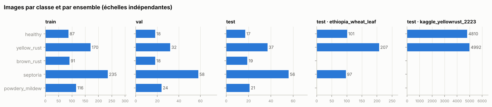
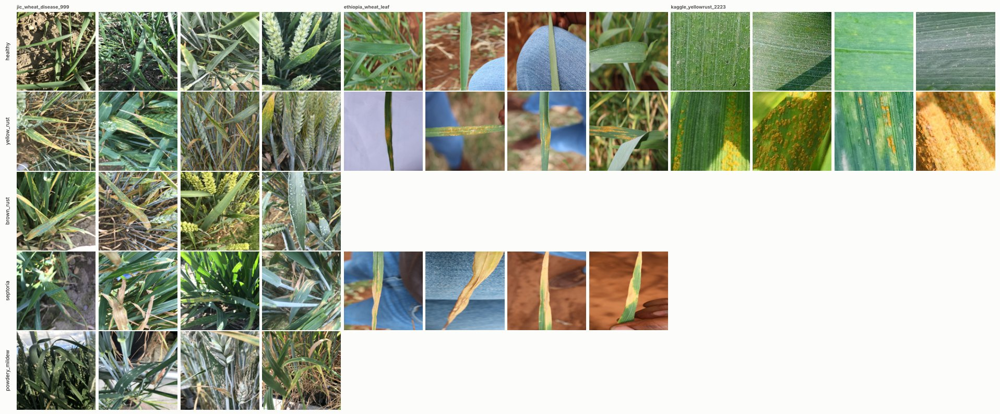
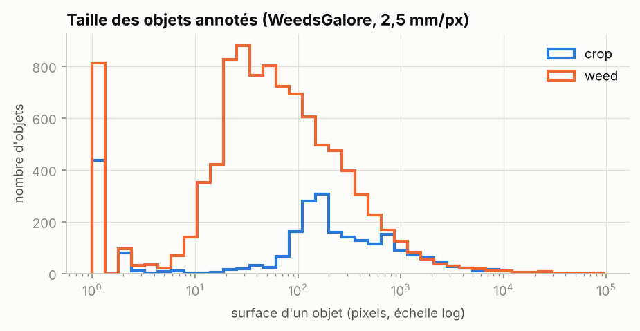
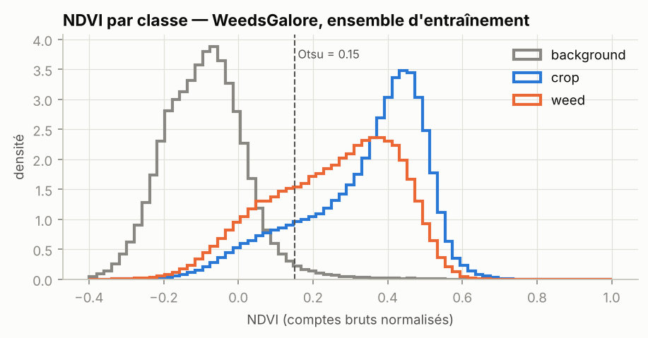
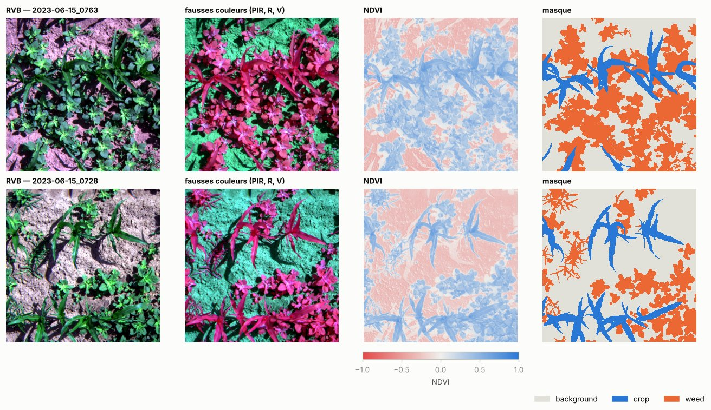
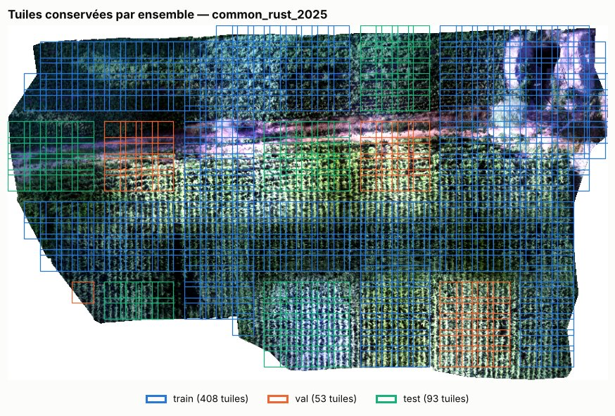

# Pipeline de données (chantier 2)

_7 octobre 2026. Tout est reproductible avec les commandes ci-dessous ; les données
restent hors de git (`data/`), les décisions et empreintes sont versionnées._

```bash
uv run agridrone data list                          # sources, statut, licence
uv run agridrone data download --include-candidates # téléchargement vérifié + extraction
uv run agridrone data verify                        # revérifie les empreintes
uv run agridrone data prepare-classification        # maladies du blé, dossiers par classe
uv run agridrone data prepare-segmentation          # multispectral N bandes + tuilage
uv sync --group notebooks && uv run jupyter lab notebooks/01_exploration_donnees.ipynb
```

Prérequis système pour les archives RAR : `unar` (`apt install unar`, `brew install unar`),
ou à défaut `unrar` / `7z`. Le décodeur RAR de `bsdtar` échoue sur le jeu d'Éthiopie
(erreurs CRC sur une archive pourtant intègre : son SHA-256 correspond à celui publié).

## 1. Sources téléchargées

Registre : [`configs/data/sources.yaml`](../configs/data/sources.yaml). Empreintes des
fichiers sans somme publiée : [`configs/data/sources.lock.yaml`](../configs/data/sources.lock.yaml).

| Source | Statut | Licence | Rôle | Fichiers vérifiés |
|---|---|---|---|---|
| John Innes Centre, 999 images | retenue | CC BY 4.0 | entraînement chantier 4 | md5 publié (Zenodo) |
| Feuilles de blé, Éthiopie | retenue | CC BY 4.0 | test inter-sources | sha256 publié (Mendeley) |
| YellowRust_22-23 (Kaggle) | candidate | CDLA-Permissive-1.0 | test inter-sources | sha256 enregistré au 1er téléchargement |
| Henan, Chine (Zenodo 15621359, ajout du 8 oct.) | candidate | CC BY 4.0 | test inter-sources | md5 publié (Zenodo) |
| Tekirdağ, Turquie (Zenodo 13137587, ajout du 8 oct.) | retenue | CC BY 4.0 | test inter-sources (oïdium) | md5 publié (Zenodo) |
| WeedsGalore | retenue | CC BY 4.0 | chaîne N bandes (chantier 5) | taille + sha256 enregistré |
| Maïs, stress hydrique et rouille (Turquie) | retenue | CC BY 4.0 | lecture et tuilage | md5 publiés (Zenodo) |

**Exclues après inspection du contenu** (décision tracée dans le registre) :

- *Wheat Leaf Disease Dataset for DL Classification* (Kaggle, CC BY 4.0 déclaré) : c'est
  une compilation. Elle contient les images d'Éthiopie (même appareil, même date), des
  images de Yellow-Rust-19 (licence « Unknown »), des noms au format John Innes et des
  images web (.jfif, .webp, vignettes, photos de 2006). La licence déclarée ne peut pas
  couvrir des images reprises ailleurs.
- *Wheat Plant Diseases* (kushagra3204) et ses copies : compilation sans provenance,
  recopiée sous d'autres licences. *Wheat Rust Raw Dataset* (MIT) contient exactement
  les 5 421 images brutes de Yellow-Rust-19.
- WFD2020 : conditions non commerciales.

**Correction de l'inventaire** : les images d'Éthiopie viennent d'un **Canon EOS Rebel
T6i** (EXIF), toutes prises le **31 mars 2021**, et non d'un Canon 5D Mark III.

## 2. Formats unifiés

| Tâche | Emplacement | Format |
|---|---|---|
| Classification | `data/processed/classification/<ensemble>/<classe>/<source>__<fichier>` | liens physiques vers les images d'origine (pas de copie) + `manifest.csv` (une ligne par image, raison d'exclusion comprise ; colonne `file` = chemin dans le jeu préparé) + `summary.json`. Deux images homonymes d'une même source reçoivent un suffixe tiré de leur sha1 : aucune ne peut écraser l'autre |
| Segmentation N bandes | `data/processed/segmentation/<jeu>/images/*.npy` + `masks/*.png` | float32 (C, H, W), bandes nommées dans `dataset.json` ; masque uint8, 255 = pixel ignoré ; `index.csv` (ensemble, pixels par classe) ; `band_stats_train.json` |
| Tuiles d'orthophoto | `data/processed/segmentation/maize_orthotiles/<ortho>/<ensemble>/*.tif` | GeoTIFF par tuile (géoréférencement conservé), pixels invalides en NaN, index CSV |
| Détection (YOLO) | — | reportée avec les pucerons |

**Bandes nommées, jamais positionnelles.** Les capteurs sont décrits dans
[`configs/sensors/`](../configs/sensors/). L'ordre de stockage diffère d'un capteur à
l'autre :

- MicaSense RedEdge : B, V, R, **PIR, RE** (tableau 1 de l'article Ir-UNet) ;
- DJI P4 Multispectral : B, V, R, **RE, PIR**.

`select_bands()` réordonne par nom, et un test le vérifie sur les deux ordres.

## 3. Découpage train / val / test (jamais au hasard par image)

| Jeu | Unité de groupe | Ensembles | Remarques |
|---|---|---|---|
| John Innes | grappes de quasi-doublons ∪ même jour EXIF ∪ séries de fichiers consécutifs (numéros à ≤ 2 d'écart, même classe) | 699 / 150 / 150 (70/15/15 en images) | pas de date ni de parcelle connue pour 974 images sur 999 : la numérotation des fichiers sert d'indice de série de prises de vue |
| Éthiopie | — | test inter-sources (405) | une seule journée de prise de vue |
| YellowRust_22-23 | — | test inter-sources (9 802) | 26 jours, 2 smartphones ; les dossiers train/val/test d'origine sont ignorés |
| Henan | — | test inter-sources (2 402) | fusariose et septoriose de l'épi écartées (hors classes), analysées à part |
| Tekirdağ | — | test inter-sources (408) | dossiers d'origine ignorés |
| WeedsGalore | **découpage officiel spatial** : 8/2/2 parcelles ; une localisation n'apparaît jamais dans deux ensembles, même à des dates différentes | 104 / 26 / 26 échantillons | 4 dates (mai–juin 2023) |
| Patchs maïs | blocs de 1024 px de chaque orthomosaïque | 628 / 135 / 133 | pseudo-étiquettes (voir § 6) |
| Tuiles d'orthophoto | blocs de 1024 px ; une tuile qui déborde sur un bloc d'un autre ensemble est écartée | 554 tuiles (rouille), 551 (stress hydrique) | aucun pixel partagé entre ensembles (test dédié) |

Les liens de groupe ne relient que des images d'un même rôle (entraînement ou test) :
ajouter un jeu de test ne modifie jamais le découpage d'entraînement (test dédié ; vérifié
lors de l'ajout du Henan et de Tekirdağ).

**Fuites contrôlées automatiquement** (`assert_no_group_leakage`, appelé à chaque
préparation) :

- **Doublons exacts** (sha1) : 192 écartés (191 dans YellowRust, recopiés entre ses
  dossiers d'origine ; 1 en Éthiopie). L'occurrence d'entraînement est toujours conservée.
- **Quasi-doublons** : candidats en dHash 64 bits (≤ 8), confirmés en dHash 256 bits
  (≤ 12). Sur ces données, les vrais doublons sont à moins de 10 et les images seulement
  semblables à plus de 20 ; toutes les paires candidates entre sources différentes
  étaient des faux positifs (≥ 76) et ont été rejetées. Dans un jeu de test, une seule
  image par grappe est gardée (8 retirées). Une image de test qui a un quasi-doublon à
  l'entraînement est retirée (0 cas ici).



## 4. Augmentations (`src/agridrone/data/augment.py`)

- **RVB** : recadrage avec changement d'échelle (0,5–1, variation d'altitude), rotations
  de 90°, symétries, flou de bougé ou de mise au point, luminosité / contraste / gamma
  (exposition), compression JPEG (liaison radio).
- **Multispectral** : géométrie (rotations de 90°, symétries, échelle 0,8–1,25 avec
  interpolation au plus proche voisin pour le masque), flous et **gain global** (même
  facteur sur toutes les bandes). Un test vérifie que les rapports entre bandes, donc
  NDVI et NDRE, sont inchangés à 1e-4 près. Ni teinte, ni saturation, ni contraste par
  bande, ni permutation de canaux.
- **Piège évité** : albumentations écrête les images float à [0, 1]. Les augmentations
  multispectrales s'appliquent donc sur des valeurs dans [0, 1] (réflectance, ou comptes
  bruts / 65535) ; la normalisation z-score par bande vient **après**.
- **Réductions sans repliement** : toute réduction de taille passe par une moyenne de
  surface (`INTER_AREA`). Une interpolation bilinéaire qui divise la taille par plus de 2
  (6000 px ramenés à 224) crée du repliement qui efface ou déforme les petits symptômes.
- **Évaluation** : plus petit côté ramené à la taille d'entrée, puis recadrage central
  carré. Les images 3:2 ne sont plus déformées.
- **Graines par worker** (corrigé au chantier 4) : le `Compose` d'albumentations a son
  propre générateur, insensible aux graines globales. Sans réensemencement dans chaque
  worker du DataLoader, chaque époque rejouait la même suite d'augmentations, et les
  workers la même suite entre eux. `seed_worker` appelle désormais `dataset.reseed()`
  avec une graine propre au worker et à l'époque (test dédié).
- **Dézoom en segmentation** : les bords créés par un dézoom reçoivent l'étiquette 255
  (ignorée par la perte), et non « fond ».

## 5. Normalisation par bande (`src/agridrone/data/normalize.py`)

| Méthode | Quand | Statistiques |
|---|---|---|
| `reflectance` | réflectance calibrée (panneau de calibration + capteur d'ensoleillement) | facteur d'échelle du capteur |
| `percentile` | comptes bruts non calibrés | p2 / p98 par bande, ensemble d'entraînement |
| `zscore` | entrée du réseau, après augmentation | moyenne / écart-type par bande, ensemble d'entraînement |

Aucun jeu public retenu n'est en réflectance calibrée : WeedsGalore fournit des comptes
16 bits, le jeu maïs des valeurs normalisées par ses auteurs. Les statistiques
d'entraînement de WeedsGalore sont dans `band_stats_train.json`. Pour vos futures
données drone, la calibration radiométrique (panneau avant chaque vol) est le prérequis
pour que les modèles et les seuils d'indices se transfèrent d'un vol à l'autre.

## 6. Ce que montre l'exploration ([notebook](../notebooks/01_exploration_donnees.ipynb))

**Écart de domaine entre sources de classification.** John Innes montre des couverts au
champ (feuilles et épis, 709×756 px en médiane), le plus proche d'une vue drone basse.
L'Éthiopie montre une feuille tenue à la main devant un jean, une main ou du papier
(6000×4000 px), avec un **risque de biais de fond** : le modèle peut apprendre le fond
plutôt que le symptôme. YellowRust_22-23 est fait de gros plans de la surface d'une
feuille (256×256 px). Les tests inter-sources du chantier 4 mesureront cet écart.



**Taille des objets (WeedsGalore, 2,5 mm/px).** Un plant de maïs fait 161 px en médiane
(10,1 cm²) et une tache d'adventice 53 px (3,3 cm²). À 1 cm/px (une P4M à 20 m donne
1,04 cm/px selon Nguyen et al. 2023), ce seraient environ 10 et 3 pixels : la segmentation fine impose
de voler bas, alors que des foyers de maladie de plusieurs mètres restent visibles plus
haut. On note aussi beaucoup de composantes d'un seul pixel (bruit d'annotation), à
filtrer avant toute analyse par objet.



**Séparabilité par indice.** Le NDVI, calculé sur comptes bruts, sépare sol et végétation
avec un seuil d'Otsu à 0,15 : 2 % des pixels de sol au-dessus, contre 84 % du maïs et
72 % des adventices. Il **ne sépare pas** maïs et adventices (médianes 0,38 contre 0,28,
distributions qui se chevauchent largement). C'est la question du chantier 5 : un U-Net
doit faire mieux qu'un seuil d'indice là où l'indice échoue.




**Jeu maïs.** Les classes de stress hydrique sont très rares (moins de 1,5 % des pixels) et
la part de rouille varie de 4 % à 16 % selon l'ensemble. Les masques sont des
pseudo-étiquettes dérivées d'indices : ce jeu sert à tester la lecture et le tuilage,
jamais à évaluer un modèle contre une baseline par indices.

**Tuilage.** Ces orthomosaïques ne codent pas leurs zones vides en nodata (valeur 0, ou
proche de 0, avec un alpha nul). La validité est donc prise sur le canal alpha, sans quoi
302 tuiles vides auraient été conservées. Un test reproduit ce piège.



## 7. Limites et suites

- **Aucune donnée publique ne reproduit la vue drone pour les maladies** : les modèles du
  chantier 4 seront des classifieurs « feuille ou couvert en gros plan ». Le transfert
  vers vos images drone devra être mesuré sur vos propres données.
- **John Innes est petit** (999 images). Le jeu complet de 19 172 images est disponible sur
  demande, si la démarche devient possible un jour.
- **YellowRust_22-23** reste « candidate » (provenance non confirmée par l'auteur) : il sert
  de test et n'entre jamais dans l'entraînement.
- La conversion YOLO (détection) est reportée avec les pucerons.
